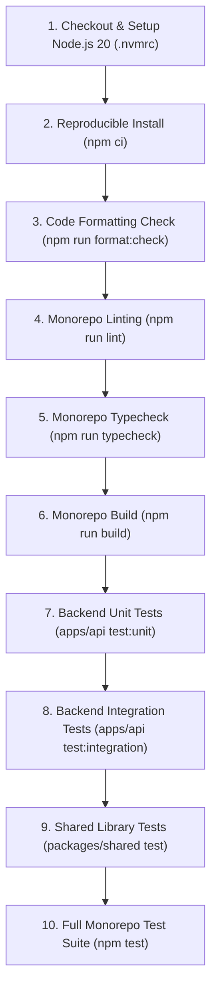

# StockPilot — Central Continuous Integration (CI) Foundation

**Document:** `docs/ci-foundation.md`  
**PR:** PR 10 — CI Foundation  
**Status:** Implemented  
**Classification:** Foundational Architecture Specification

---

## 1. Overview

The StockPilot Continuous Integration (CI) foundation establishes a centralized, deterministic, fast, and secure automated quality gate across the monorepo. It replaces fragmented, PR-specific legacy validation files with a single authoritative workflow (`.github/workflows/ci.yml`) executed on GitHub Actions.

---

## 2. CI Architecture & Workflow Responsibilities

### 2.1 Workflow Layout

```text
.github/workflows/
└── ci.yml             # Central CI workflow validating all pull requests & main pushes
```

### 2.2 Event Triggers

| Event               | Target            | Purpose                                              |
| ------------------- | ----------------- | ---------------------------------------------------- |
| `pull_request`      | Any target branch | Validates proposed changes before merge              |
| `push`              | `main`            | Validates post-merge integrity on trunk              |
| `workflow_dispatch` | Manual execution  | Enables on-demand verification from GitHub UI or CLI |

### 2.3 Concurrency Control

```yaml
concurrency:
  group: ${{ github.workflow }}-${{ github.ref }}
  cancel-in-progress: true
```

Prevents runner resource contention: when a developer pushes new commits to an active PR branch, any running job for an older commit on that branch is automatically cancelled, ensuring immediate feedback on latest code.

### 2.4 Security & Least Privilege

- **Permissions:** Restricted globally to `contents: read`.
- **Zero Secrets:** The CI pipeline runs completely offline from production infrastructure; no production credentials, database passwords, or JWT secrets are required or exposed.

---

## 3. Ordered Quality Gates

The `validate` job (`Validate Monorepo Quality Gates`) executes the following sequential stages:



### Gate Descriptions

1. **Dependency Installation (`npm ci`):** Strictly adheres to `package-lock.json` with npm cache enabled.
2. **Formatting Gate (`npm run format:check`):** Verifies Prettier code style without mutating files in-place.
3. **Linting Gate (`npm run lint`):** Executes ESLint across workspaces (`@stockpilot/web`, `@stockpilot/shared`) with `--max-warnings 0`.
4. **Typecheck Gate (`npm run typecheck`):** Verifies TypeScript compilation types across all workspaces without code emit.
5. **Build Gate (`npm run build`):** Compiles `@stockpilot/shared`, `@stockpilot/api`, and builds `@stockpilot/web` via Vite.
6. **Backend Unit Tests (`npm run test:unit -w @stockpilot/api`):** Executes isolated unit tests (`config.test.js`, `test-infrastructure.test.js`).
7. **Backend Integration Tests (`npm run test:integration -w @stockpilot/api`):** Executes Express HTTP routing, error boundaries, and logging integration tests.
8. **Shared Library Tests (`npm test -w @stockpilot/shared`):** Executes unit tests for errors, logger, and contract constants.
9. **Full Monorepo Test Suite (`npm test`):** Executes full end-to-end unit and integration test suite (78 tests total).

---

## 4. Local Execution & Failure Diagnosis

Developers can reproduce any CI check locally using the exact same commands executed on GitHub Actions:

```bash
# 1. Reproducible dependency install
npm ci

# 2. Check code formatting
npm run format:check

# 3. Check linting
npm run lint

# 4. Check TypeScript types
npm run typecheck

# 5. Build all packages and applications
npm run build

# 6. Run API unit tests
npm run test:unit -w @stockpilot/api

# 7. Run API integration tests
npm run test:integration -w @stockpilot/api

# 8. Run full test suite across all workspaces
npm test
```

### Diagnosing Common Failures

- **Formatting failure (`Prettier found issues`):** Run `npm run format` locally, inspect git diff, and commit the formatted changes.
- **TypeScript failure (`TS2304 / TS2322`):** Run `npm run typecheck` to locate the file and line number.
- **Module import failure (`Cannot find module .../dist/...`):** Run `npm run build` to ensure compiled JavaScript artifacts exist.
- **Test assertion failure:** Run the focused test file using `node --test apps/api/test/<test-file>.js`.

---

## 5. Scope Boundaries & Future Roadmap

In compliance with the 100-PR Roadmap:

- **PR 10 establishes CI validation only.**
- **Deployment pipelines (Docker, Kubernetes, AWS, Cloud):** Reserved for PR 98.
- **Production security hardening:** Reserved for PR 99.
- **Production release & tagging:** Reserved for PR 100.
